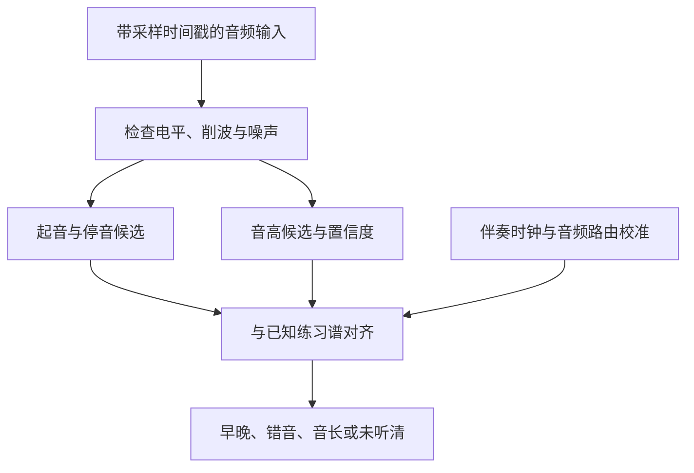

# ChatGPT 调研报告（原文存档）

> 存档日期：2026-11-10。来源：ChatGPT 调研，由产品负责人提供。本文件是原文存档，不随项目进展更新。
>
> **阅读前必须知道的两个已知问题**（产品负责人指出，详见 `../01_FEASIBILITY.md` 第 0 节）：
> 1. 报告高估了竞品（尤其是 Yousician）的拾音能力，把官方功能说明当成了能力基线。竞品实际表现以真琴实测为准（`../06_BENCHMARK_PROTOCOL.md`）。
> 2. 报告把接线路线只当作“可靠性基准”。在本项目里接线是主路线（`../adr/ADR-001-wired-input-first.md`）。
>
> 另有一处经核实需要更正：报告没有提到“接口同时充当输出设备”这一点，因而把蓝牙耳机听伴奏当成了默认场景。见 `../01_FEASIBILITY.md` Q3。

---

# 电贝斯引导式学习 App：竞品、技术与教学内容调研

**调研截至：2026 年 11 月 10 日。**

**总体判断：值得做一个范围明确的自用原型；商业化的关键，是把可靠的演奏反馈与清晰的日常学习路径结合起来。** 贝斯课程本身已经有强竞争者，实时识音也已有成熟产品。比较值得验证的空缺，是面向特定人群——例如以日本流行乐和爵士为目标的成年初学者——提供“今天练什么、刚才哪里有问题、下一次怎么改”的完整体验。

本报告采用以下证据口径：

- **官方事实**：官网、帮助中心、应用商店、论文、源码或权利管理机构公开说明；功能宣传不等于独立测试结果。
- **用户反馈**：可核验的评论和讨论，只作为问题线索，不推算投诉率，也不把历史问题视为当前版本必然存在。
- **判断／建议**：根据上述资料作出的产品与工程判断，明确标出。
- 除另标发表或更新日期外，来源均为 **2026-11-10 查阅**；页面未标发布日期的，不补造日期。
- 本次是公开资料调研，**没有用真实贝斯、不同 iPhone 和付费账户做横向实测**。各家识音准确率、完整付费课程深度等，公开资料不足之处均保留为“未查到”。

---

# 一、竞品调研

## 1. 最直接的竞品：能够接收真实演奏声音的产品

### 1.1 Yousician：确实支持贝斯，但接入条件与支持范围需要看细则

**乐器与贝斯投入。** 产品生态覆盖吉他、贝斯、声乐、钢琴、尤克里里，其中部分乐器使用独立 App。贝斯有自己的课程、演奏技巧和乐理内容，不能简单视为把吉他指板换成四根弦。官方称课程由音乐教师与贝斯手设计；**当前贝斯课程总设计者姓名、完整分级数量未查到**。日区商店描述还明确表示，目前日语课程仅覆盖吉他，因此“有日语界面”不能等同于“有日语贝斯教学”。[Yousician](https://yousician.com/ja/Bass?utm_source=chatgpt.com)

**声音输入。** 支持麦克风和音频接口。官方对电贝斯的麦克风方案明确要求：通过音箱发声，使用 clean 音色，音量大致达到正常说话水平；音频接口是其推荐的最佳识音方式。识音帮助页明确列出真实四弦贝斯、标准 E–A–D–G 调弦。**完整支持五弦低 B、六弦或任意降调的保证未查到。**[Yousician Support](https://support.yousician.com/hc/en-us/articles/207613719-Choosing-your-set-up-for-bass?utm_source=chatgpt.com)

**反馈与课程形式。** 实时反馈音高和 timing，以彩色 TAB／音符、命中提示、成绩和分级进度呈现，配合循环、变速和技巧练习。其显示的指法提示属于教学标注，不能据此推断系统识别了你实际用了哪根手指。[Yousician](https://yousician.com/ja/Bass?utm_source=chatgpt.com)

**曲库与版权。** 包括教学练习及授权流行歌曲。官方明确说明，歌曲是否可用取决于乐器、国家和授权状态，授权到期可能撤曲。普通用户导入任意歌曲、自动生成完整贝斯评分课程的功能，**未查到**。[Yousician Support](https://support.yousician.com/hc/en-us/articles/360000758937-Why-can-t-I-find-a-popular-song-in-Yousician?utm_source=chatgpt.com)

**判断：** 是必须实际体验的第一梯队竞品。其重要参照价值不仅是跟弹界面，还有“接入失败时如何引导用户”的流程。

---

### 1.2 Rocksmith+：歌曲演奏与实时反馈最接近你的构想

**乐器与贝斯投入。** 支持吉他、贝斯、钢琴，有独立贝斯编配和教程。当前仍在运营；官方 2026 年 10 月更新中继续列出新曲的贝斯编配。不要把 Rocksmith 2014 的旧产品状态、限制和评论直接套到 Rocksmith+。[Ubisoft (EU / UK)](https://www.ubisoft.com/en-gb/game/rocksmith/plus?utm_source=chatgpt.com)

**声音输入。** 移动端可使用设备内置麦克风，接收音箱播放的电吉他／电贝斯，也可使用兼容的移动音频接口。PC 端另外提供 Real Tone Cable、第三方接口和手机充当麦克风等方案。这里要区分：

- **Rocksmith+ iOS 主 App**：在手机上学习。
- **Rocksmith Tuner／原 Connect**：可把手机作为另一台设备运行 Rocksmith+ 时的输入端。

“手机能当麦克风”与“手机上运行完整学习 App”是两个不同功能。[Ubisoft (EU / UK)](https://www.ubisoft.com/en-gb/game/rocksmith/plus?utm_source=chatgpt.com)

**反馈。** 实时音符识别、命中与错音反馈，使用 3D Noteway 和 TAB，提供 Riff Repeater、Note by Note、速度调整和自适应难度。**对闷音质量、手型、音色是否达到教师级评估，未查到证明。**[App Store](https://apps.apple.com/jp/app/rocksmith-%E9%9F%B3%E6%A5%BD%E5%AD%A6%E7%BF%92%E3%82%A2%E3%83%97%E3%83%AA/id1571139807?utm_source=chatgpt.com)

**课程设计。** 2022-05-19 的开发日志由音乐教育设计负责人 Greg Studley 解释：每课包含专业教师视频和专门创作的 Practice Track，把刚学的技能放进短曲中练习；困难时用降速、循环和逐音模式处理。这个“讲解—专项练习—反馈”的结构，比单纯曲库更值得参考。[Late May 2022: Lessons](https://www.ubisoft.com/en-gb/game/rocksmith/plus/news-updates/7ncvKJE9PCWmNWNrqmU5WJ/rocksmith-dev-diary-late-may-2022-lessons?utm_source=chatgpt.com)

**曲库与版权。** 提供授权原版录音等内容；Workshop 允许用户围绕授权库制作编配，不等于开放任意商业歌曲上传。日本官方发布资料曾列出あいみょん、ちゃんみな等日本艺人，但**具体歌曲今天在日本地区是否具有可练的贝斯编配，需要逐曲核实**，不能由艺人名单或全平台总曲数推断。[App Store](https://apps.apple.com/jp/app/rocksmith-%E9%9F%B3%E6%A5%BD%E5%AD%A6%E7%BF%92%E3%82%A2%E3%83%97%E3%83%AA/id1571139807?utm_source=chatgpt.com)

**判断：** 是最接近“真实乐器＋歌曲＋自动反馈”的直接标杆。你要验证的差异，应落在初学引导、反馈解释和特定曲风学习上。

---

### 1.3 Fender Play：有独立贝斯课程，但自动反馈覆盖存在资料空白

**乐器与课程。** 支持吉他、贝斯和尤克里里。官方 My Path 为不同乐器设置独立路线，从持琴、拨弦、按音开始，再加入技巧、乐理和歌曲／riff 应用。贝斯不是只有调音器入口。课程由 Fender 教师团队提供；**当前贝斯课程总负责人未查到**。[Instructor Guide](https://lausd-instructor.fender.com/hc/en-us/articles/360043846152-My-Path?utm_source=chatgpt.com)

**声音与反馈。** 视频跟练无需音频接入。官方教学端的新版 Practice Session 文档描述了滚动 TAB、节拍器、多轨伴奏，以及通过麦克风录制后给出音高、节奏和改进位置的反馈。这里有重要边界：

- 这是**录制后反馈**的公开证据。
- **消费版 iOS 的贝斯课程覆盖比例、接口兼容范围、是否逐音实时评分，未查到。**
- 旧资料曾把 Feedback Mode 限于吉他，但不能据此断言 2026 年贝斯仍完全不支持。[Instructor Guide](https://lausd-instructor.fender.com/hc/en-us/articles/48066242196493-Practice-Session?utm_source=chatgpt.com)

**内容。** 使用知名歌曲和 riff 讲授技能；具体授权合同、用户自行导入歌曲后评分的功能，**未查到**。[App Store](https://apps.apple.com/jp/app/fender-play-learn-guitar/id1226057939?utm_source=chatgpt.com)

**判断：** 值得研究短课与练习组织方式；在立项评审中，不宜把它直接列为“已确认覆盖贝斯实时评分”的产品。

---

### 1.4 Bass Guitar Tutor／Pro：专门面向贝斯的小型产品

由 Learn To Master 开发，包含虚拟指板、音阶、指板音名、常见 bass pattern、乐句记忆及跟练。官方明确说可以配合真实贝斯分析音高；iOS 更新记录也提到 pitch analysis 和噪声阈值改进。因此它并非纯粹的触屏模拟器。[Learn To Master](https://learntomaster.com/bass_guitar_tutor.html?utm_source=chatgpt.com)

但以下信息**未查到**：完整的零基础教学设计者、可靠的音频接口兼容表、最低可识别频率、量化节奏评分方法、真实乐器端到端延迟和准确率。五弦指板选项也不能证明低 B 已得到可靠验证。歌曲 bass line 的具体授权方式同样未公开。[App Store](https://apps.apple.com/us/app/bass-guitar-tutor/id658482268?utm_source=chatgpt.com)

**判断：** 对个人开发者尤其值得研究：它表明“专用、范围小”的贝斯工具可以成立，但也暴露出课程、内容校对和技术透明度的不足。

---

## 2. 贝斯教学内容的强竞争者

这些产品主要依靠视频、谱面、伴奏和人工反馈。它们会争夺用户的学习时间和预算，即使不采用自动识音，也不能从竞品范围中排除。

| 产品 | 乐器、课程与负责人 | 获取声音与反馈 | 曲库及版权信息 |
|---|---|---|---|
| **BassBuzz — Beginner to Badass** | 贝斯专用；Josh Fossgreen 主讲，与 JP Allen 合作。以循序渐进课程及慢／中／原速 workouts 引导零基础。主要是网站，独立原生 iOS 学习 App **未查到**。 | 视频跟弹无需传入声音；自动音高／节奏评分**未查到**。 | 教学练习、伴奏与歌曲内容；额外 100 Songs Pack 明确标注通过 NoteFlight 授权，不能推断全部课程均采用同一种许可。[BassBuzz.com](https://www.bassbuzz.com/lessons/beginner?utm_source=chatgpt.com) |
| **Scott’s Bass Lessons，SBL Academy** | 贝斯专用学校；Scott Devine、Ian Martin Allison 等。包含 Players Path、Learning Pathways、专题课程和爵士内容。入门 Level 1 由 Ian 引导。完整 Academy 原生 iOS App **未查到**。 | 视频、谱例、伴奏、直播及人工反馈；自动实时判分**未查到**。与 Groove Trainer 工具 App 分开。 | 有专门教学曲和演奏项目；主流商业曲库的整体授权细节**未查到**。[Scott's Bass Lessons](https://scottsbasslessons.com/learning-pathways/learning-pathway-beginner-1?utm_source=chatgpt.com) |
| **Musora／PlayBass** | Musora 覆盖鼓、钢琴、吉他、声乐、贝斯；PlayBass 是官方列出的 2026 年新品牌。具名贝斯课程包括 Moa Munoz 的 30 Day Bass、Ernest Tibbs 的 Blues 课程等。 | 视频、互动谱面、变速循环、去贝斯伴奏及教师支持；贝斯自动麦克风音高／节奏评分**未查到**。 | 官方宣传专业转谱歌曲和简化版本；逐曲日本可用性、完整授权条款**未查到**。[We Exist To Create More Musicians](https://www.musora.com/about?utm_source=chatgpt.com) |
| **Pickup Music** | 吉他、贝斯、钢琴；贝斯有独立 beginner、jazz、funk、walking 等路径。Corbin Jones 主持入门路线，按 grade、日课和演奏作品推进。 | 日常视频跟练；可提交演奏视频给真人教练，属于异步人工反馈。自动音频评分**未查到**。 | 课程包含原创演奏作品和乐队伴奏；任意歌曲导入评分及完整商业曲库许可**未查到**。[Pickup Music](https://www.pickupmusic.com/bass/bass-classes/beginner-learning-pathway?utm_source=chatgpt.com) |

**一个会改变产品定位的事实：成熟课程已经很早教闷音。** SBL 入门路线第二课就是拨弦手与闷音；Pickup Music 的入门第二天也包含音长和闷音。因此，“其他产品只教音符、不教贝斯演奏”这个竞争假设不成立。真正值得探索的是，如何把这些已有的教学思想接上可靠、低负担的练习反馈。[Scott's Bass Lessons](https://scottsbasslessons.com/learning-pathways/learning-pathway-beginner-1?utm_source=chatgpt.com)

Musora 的公开贝斯页面还存在部分课程文案与模板不一致的情况。本报告只采用明确标注贝斯、具名教师的课程资料，**没有据此认定实际付费课程错乱，也没有把网页上的完整课程列表当作已核实大纲**。

---

## 3. 曲谱、伴奏与专项练习工具

| 产品 | 乐器与贝斯支持 | 声音输入、反馈和呈现 | 教学与内容来源 |
|---|---|---|---|
| **Songsterr** | 吉他、贝斯、鼓多轨 TAB；贝斯声部是真实产品组成，但不是零基础课程。 | 滚动 TAB、同步音源、变速、循环、solo／mute。麦克风或 iRig 可用于调音；根据真实贝斯连续评分的功能**未查到**。 | 用户共同制作、修订曲谱；官方明确支付版权费，也承认曲谱可能错误或不完整。现有 AI 转谱入口不意味着生成结果已经过教师校对。[Songsterr Tabs with Rhythm](https://www.songsterr.com/help?utm_source=chatgpt.com) |
| **Ultimate Guitar** | 吉他、贝斯、尤克里里；用户 TAB 与 Official／Pro 内容并存。贝斯专用入门课程主线**未查到**。 | 交互 TAB、伴奏、自动滚动、变速、节拍器；调音器会拾音。完整贝斯实时音高／节奏评分**未查到**。 | 用户投稿和平台制作曲谱；可修改个人谱。具体各类内容的版权合同、任意音频导入评分**未查到**。[apps.apple.com](https://apps.apple.com/jp/app/ultimate-guitar-chords-tabs/id357828853?utm_source=chatgpt.com) |
| **Moises** | 多乐器练习工具，可分离、静音或突出贝斯声部。 | 主要处理用户导入的音频：stem separation、变速、移调、和弦、节拍辅助。不是在听你的贝斯并判分。 | 没有完整零基础贝斯课程；用户导入内容，不是购买订阅便获得任意流行歌曲的再分发权。[apps.apple.com](https://apps.apple.com/jp/app/moises-the-musicians-app/id1515796612?l=en-US\&utm_source=chatgpt.com) |
| **SBL Groove Trainer** | 贝斯导向的节拍器、鼓 loop、调音器、beat trainer 工具。 | 麦克风用于调音；跟真人鼓 loop 练习。自动演奏节奏评分**未查到**。 | 无完整零基础路线；鼓 loop 包含 Mark Guiliana、Nate Wood 等演奏者内容。[App Store](https://apps.apple.com/jp/app/sbl-groove-trainer/id1571452765?utm_source=chatgpt.com) |

**判断：** 这类工具可以成为你学习过程的组成部分，但它们分别解决“找谱”“听清原曲”“获得伴奏”“控制练习速度”。把这些能力包装在一起，并不自动产生教学上的引导能力。

---

## 4. 日本厂商与日文独立产品

### 4.1 Yamaha Extrack

Yamaha 于 **2025-03-18** 发布。支持导入音乐并分离包括贝斯在内的声部，提供和弦分析、变速、循环等练习功能。它分析的是导入歌曲，**没有查到根据用户实际演奏进行评分，也没有零基础贝斯课程**。[ヤマハ株式会社](https://www.yamaha.com/ja/news_release/2025/25031801/?utm_source=chatgpt.com)

内容由用户导入。官方明确说明，并非 Apple Music 等流媒体中的歌曲都可导入；不能把订阅流媒体访问权限当成可自由处理、分发的音频文件。对你的项目而言，它更适合研究日本用户的跟曲练习流程和本地音源管理。[jp.yamaha.com](https://jp.yamaha.com/apps/products/extrack/index.html?utm_source=chatgpt.com)

### 4.2 Yomu Fumen β／ギター・ベース初見トレーニング

这是日文 Web 产品，**不是原生 iOS App**。官方列出：

- 生成 4／8／16 小节练习；
- 音高、节奏、音高与节奏结合的训练；
- 麦克风输入、屏幕音名键盘或自评；
- 按吉他／贝斯弦数设置，保存本地练习记录。

它提供读谱文章，但不构成持琴到完整演奏的系统课程。官方说明内容制作使用 AI，并由有识者确认；**具体教师身份、低 E 准确率、接口支持表未查到**。其自身也提示麦克风判断受设备和环境影响。[yomu-fumen.com](https://yomu-fumen.com/about.html?utm_source=chatgpt.com)

### 4.3 Metronoamee

日本开发者 Yasuyuki Hamada 的节奏练习 App。支持触屏输入，以及麦克风或音频接口输入；通过时间线、直方图、瀑布式显示和练后分数，呈现抢拍、拖拍及节奏偏差，并提供延迟补偿。**音高评分、贝斯专用课程未查到。**[App Store](https://apps.apple.com/jp/app/metronoamee/id6738761923?utm_source=chatgpt.com)

它的“按下／松开时间评分”有明确的触屏应用场景，**不能直接推断为已经能可靠评价真实贝斯的停音与闷音**。内容是节奏训练模式，不以授权流行曲库为核心。

### 4.4 ベースでコードトーン

日本贝斯教师星野徹介绍的和弦内音练习工具，围绕三度、五度、七度等指板知识训练，适合爵士入门后的理论巩固。公开介绍为免费、无广告；主要是屏幕答题，真实贝斯音频评分和完整零基础路线**未查到**。精确发布日期未核实，来源查阅于 2026-11-10。[Line on Bass](https://basslesson.toruhoshino.com/chordtone-app-release/?utm_source=chatgpt.com)

**日本市场判断：** 本次查到的日本厂商及日文独立产品中，伴奏处理、读谱、节奏和和弦内音等专项工具比较明确；**同时具备原生 iOS、完整日语贝斯入门课程、可靠实时演奏评分和授权 J-pop 练习曲的本土产品，未查到**。这是本次检索的结果，不能证明市场上绝对不存在。

---

## 5. 其他乐器的重要参照

这些产品不支持贝斯，但有可借鉴的交互机制。

| 产品 | 支持范围与输入 | 实时反馈与引导 | 课程、曲库和待核实项 |
|---|---|---|---|
| **Simply Guitar** | 吉他；官方 **2024-12-11** 明确不支持贝斯或尤克里里。主要通过麦克风识音。 | 音符／和弦反馈、分步练习；量化节奏评分细则**未查到**。 | 教师设计课程，从基础到和弦与歌曲。完整版权合同和现行总设计者姓名**未查到**。不要把 Simply Tune 能调贝斯理解为 Simply Guitar 能教贝斯。[Simply Piano Help Center](https://piano-help.hellosimply.com/en/articles/6087918-can-i-play-with-a-ukulele-bass-or-other-instrument?utm_source=chatgpt.com) |
| **Simply Piano** | 钢琴；麦克风或 MIDI。 | 实时识音、分句练习、单手到双手、读谱与和弦路线。 | 音乐教育者参与设计。官方帮助页 **2026-09-14** 更新说明，歌曲需先取得许可，再制作教学版本。[apps.apple.com](https://apps.apple.com/jp/app/simply-piano-%E3%83%94%E3%82%A2%E3%83%8E%E7%B7%B4%E7%BF%92-%E7%8B%AC%E5%AD%A6%E3%81%A7%E6%A5%BD%E3%81%97%E3%81%8F%E4%B8%8A%E9%81%94/id1019442026?utm_source=chatgpt.com) |
| **flowkey** | 钢琴；麦克风或 MIDI。 | 视频演示与谱面对应，Wait Mode 等待弹对音，支持分手、循环。**等待正确音不等于严格节奏评分**；独立节奏评分细则未查到。 | 钢琴基础、读谱、和弦等课程及歌曲；现行方案区分曲库访问范围。完整课程总设计者名单未查到。[flowkey](https://www.flowkey.com/en?utm_source=chatgpt.com) |
| **Skoove** | 钢琴；麦克风、USB MIDI、Bluetooth MIDI。 | 实时演奏反馈、短课、视频、循环与速度工具。节奏评价的具体容差、算法**未查到**。 | 专业钢琴教师制作，涵盖读谱、乐理和流行／古典歌曲；具体授权合同未查到。[App Store](https://apps.apple.com/jp/app/skoove-%E3%83%94%E3%82%A2%E3%83%8E%E3%82%92%E7%BF%92%E3%81%86/id1160668178?utm_source=chatgpt.com) |
| **Melodics** | 整体产品覆盖键盘、打击垫、电子鼓；官方当前说明 **iPhone 版专注鼓**。 | 电子鼓走 MIDI；原声鼓／练习垫可使用麦克风。重视击打时机、节奏准确性和游戏化短练习。 | 专业音乐人课程及歌曲练习，是节奏反馈的重点参照；不提供贝斯教学。[Melodics Support](https://support.melodics.com/en/articles/9894344-melodics-for-iphone?utm_source=chatgpt.com) |

注意，**Bluetooth MIDI 传输的是演奏事件，不是蓝牙耳机音频**。不能用 MIDI 的使用体验推断 AirPods 的监听延迟。

---

## 6. 可核验的贝斯用户抱怨

以下证据主要说明“哪些问题值得验证”，不说明某产品整体不可用。

| 产品、日期与来源 | 用户实际抱怨 | 能支持的判断与边界 |
|---|---|---|
| **Yousician，2024-03-29，Reddit** | E 弦第三品的低 G 在特定位置反复不被识别；使用电脑麦克风收 Fender Rumble 音箱，AirPods 听伴奏。 | 有贝斯低音识别失败的真实报告；输入、音箱、蓝牙等因素同时存在，不能单独归因于算法。[reddit.com](https://www.reddit.com/r/yousician/comments/1br0s9q?utm_source=chatgpt.com) |
| **Rocksmith+，2024-07-09，Reddit** | Ibanez Mikro 贝斯持续被判 miss／late，只有很用力拨弦才识别。 | 提示输入电平、校准或识别门限问题。同帖另有用户认为识别很好，并提到调整拾音器改善效果。[reddit.com](https://www.reddit.com/r/rocksmith/comments/1dyzds5?utm_source=chatgpt.com) |
| **SBL，2024-09-23，Reddit** | 部分用户觉得内容分散、选择太多，需要较强自驱。 | 是导航与学习路径感受；同帖有人指出已有 Players Path。不能写成“SBL 没有结构化课程”。[reddit.com](https://www.reddit.com/r/Bass/comments/1fnrbpc/scotts_bass_lessons_or_beginner_to_badass/?utm_source=chatgpt.com) |
| **BassBuzz／Musora，2026-03-06，Reddit** | 刚开始学贝斯、已有鼓经验的用户觉得 BassBuzz 太慢，而 Musora 跨弦等进度太快。 | 表明“有音乐经验但没贝斯经验”与“完全零基础”需要不同节奏；发帖者明确认可两者质量。 |
| **Pickup Music，精确日期未查到，页面显示约 9 个月前** | Late Beginner 路线突然出现较难十六分音符，前后练习难度落差明显。 | 是课程衔接线索；讨论中也提到前一阶段已出现相关内容，不宜断言完全没有铺垫。[reddit.com](https://www.reddit.com/r/pickupmusic/comments/1qjvw0w/late_beginner_bass_occassionally_very_challenging/?utm_source=chatgpt.com) |
| **Bass Guitar Tutor Pro，2020-02-16，Google Play** | 个别歌曲所谓 bass line 实际上是吉他声部。 | 开发者 **2020-11-25** 回复称已校对纠正。属于历史内容质量问题，不能当作当前仍未修复。[Apps on Google Play](https://play.google.com/store/apps/details?hl=en_US\&id=com.veitch.learntomaster.bgtp\&utm_source=chatgpt.com) |
| **Songsterr，精确日期未查到，页面显示约 1 年前，r/Bass** | 播放游标与音符不同步、跳小节；部分回复抱怨转谱或指法质量。 | 是曲谱与播放器问题，不是实琴识音失败。也有用户反馈正常。[reddit.com](https://www.reddit.com/r/Bass/comments/1of6vny/does_anyone_else_here_think_songsterr_sucks/?utm_source=chatgpt.com) |
| **SBL Groove Trainer，2022-06-29，日区 App Store** | 鼓 loop 偶尔无法下载或播放，需要强退重开。 | 贝斯练习工具的历史稳定性问题，不是低音识别证据。[App Store](https://apps.apple.com/jp/app/sbl-groove-trainer/id1571452765?utm_source=chatgpt.com) |
| **Yamaha Extrack，2025-06-04，日区 App Store** | 分离后声音发闷、有水声感，和弦判断错误。 | 是音源分离／和弦分析问题；评论未明确只针对贝斯声部，不能改写成“贝斯识音不准”。[apps.apple.com](https://apps.apple.com/jp/app/%E3%83%A4%E3%83%9E%E3%83%8F-extrack-%E6%BC%94%E5%A5%8F%E3%81%AE%E8%80%B3%E3%82%B3%E3%83%94-%E6%A5%BD%E5%99%A8%E6%8A%BD%E5%87%BA-%E3%82%B3%E3%83%BC%E3%83%89%E9%80%B2%E8%A1%8C/id6504546276?utm_source=chatgpt.com) |

**未查到的部分：**

- Fender Play 当前版、Moises、Yomu Fumen、Metronoamee、ベースでコードトーン：未查到足以确认当前贝斯专项缺陷的公开负面样本。
- Ultimate Guitar：本次未取得能充分复核原文和日期的贝斯专项差评证据，不将零散线索作为确认缺陷。
- Simply Guitar／Piano、flowkey、Skoove、Melodics：不支持贝斯，贝斯差评不适用。
- 日区商店与日文社区检索中，**可复核的“贝斯最低 E 识别失败”专门报告较少，未形成可比较样本**。不能用吉他或钢琴的识音差评补足这一空白。

---

## 7. 综合对比与价格

**价格口径：2026-11-10 公开页面所列；¥ 为日元，US$ 为美元。** 日区 App Store 常同时保留多个订阅 SKU，可能对应历史价、促销或不同权益。表中标“示例”的，不保证是所有新用户都能买到的统一价格；网页价与 App 内价也可能不同。

| 产品 | 贝斯定位 | 实琴输入／自动反馈 | 从零引导 | 收费模式与公开价格 |
|---|---|---|---|---|
| **Yousician** | 独立贝斯路径 | 麦克风＋音箱／接口；音高＋时机 | 有 | Premium Plus 日区示例 **¥2,300/月、¥14,000/年**。[apps.apple.com](https://apps.apple.com/jp/app/yousician-%E6%A5%BD%E5%99%A8-%E3%82%B3%E3%83%BC%E3%83%89-%E6%AD%8C%E3%81%AE%E3%83%AC%E3%83%83%E3%82%B9%E3%83%B3/id959883039?utm_source=chatgpt.com) |
| **Rocksmith+** | 独立贝斯编配与教程 | 麦克风＋音箱／兼容接口；实时音符反馈 | 有 | 日区 **¥1,500/月、¥3,900/3个月、¥9,900/年**。[App Store](https://apps.apple.com/jp/app/rocksmith-%E9%9F%B3%E6%A5%BD%E5%AD%A6%E7%BF%92%E3%82%A2%E3%83%97%E3%83%AA/id1571139807?utm_source=chatgpt.com) |
| **Fender Play** | 独立贝斯路径 | 视频；麦克风练后评分文档存在，贝斯覆盖待核实 | 有 | 日区示例 **¥1,100/月、¥10,000/年**；另有多个不同价格 SKU。[App Store](https://apps.apple.com/jp/app/fender-play-learn-guitar/id1226057939?utm_source=chatgpt.com) |
| **Bass Guitar Tutor Pro** | 贝斯专用练习工具 | 麦克风音高分析；节奏评分未查到 | 系统性有限／未充分确认 | 美区 Pro **US$29.99 买断**；日区现价未查到。[App Store](https://apps.apple.com/us/app/bass-guitar-tutor-pro/id658293844?utm_source=chatgpt.com) |
| **BassBuzz** | 贝斯专用课程网站 | 视频自检；无已确认自动评分 | 强 | **US$197 一次购买**，终身线上访问。[BassBuzz.com](https://www.bassbuzz.com/lessons/beginner?utm_source=chatgpt.com) |
| **SBL Academy** | 贝斯专用学校 | 视频／人工反馈 | 有，内容广 | **US$34/月、US$199/年、US$1,997 终身**；官方更新 **2026-08-13**。[Scott's Bass Lessons](https://scottsbasslessonshelp.zendesk.com/hc/en-gb/articles/5080349573151-How-Much-Is-The-SBL-Academy?utm_source=chatgpt.com) |
| **Musora／PlayBass** | 独立贝斯品牌 | 视频、谱面、教师支持；自动识音未查到 | 有 | **US$30/月、US$279/年**，包含五种乐器。[Musora](https://www.musora.com/bass?utm_source=chatgpt.com) |
| **Pickup Music** | 独立贝斯路径 | 视频＋异步真人反馈 | 强 | **US$29.99/月、US$179.99/年**。[Pickup Music](https://www.pickupmusic.com/pricing?utm_source=chatgpt.com) |
| **Songsterr** | 贝斯曲谱与跟曲工具 | 调音器拾音；无已确认演奏评分 | 无完整路线 | 日区 Plus **¥980/月**；旧 Legacy SKU 不作为现行报价。[apps.apple.com](https://apps.apple.com/jp/app/songsterr%E3%81%AE%E3%82%BF%E3%83%96%E3%81%A8%E3%82%B3%E3%83%BC%E3%83%89/id399211291?utm_source=chatgpt.com) |
| **Ultimate Guitar** | 贝斯曲谱工具 | 调音器拾音；无已确认演奏评分 | 贝斯主线未查到 | 日区示例 Annual Pro **¥2,100/年**、Pro+ **¥2,800/年**；多 SKU。[apps.apple.com](https://apps.apple.com/jp/app/ultimate-guitar-chords-tabs/id357828853?utm_source=chatgpt.com) |
| **Moises** | 贝斯声部分离／伴奏工具 | 导入音频分析；不是演奏评分 | 无 | 日区 Premium 示例 **¥900/月、¥7,000/年**；Pro 月付 **¥4,500**。[apps.apple.com](https://apps.apple.com/jp/app/moises-the-musicians-app/id1515796612?l=en-US\&utm_source=chatgpt.com) |
| **SBL Groove Trainer** | 贝斯专项练习工具 | 调音拾音；节奏靠自检 | 无完整路线 | **免费**。[App Store](https://apps.apple.com/jp/app/sbl-groove-trainer/id1571452765?utm_source=chatgpt.com) |
| **Yamaha Extrack** | 日本厂商伴奏工具 | 导入音频分析；无已确认演奏评分 | 无 | **¥900/月、¥7,000/年**，另有免费额度。[apps.apple.com](https://apps.apple.com/jp/app/%E3%83%A4%E3%83%9E%E3%83%8F-extrack-%E6%BC%94%E5%A5%8F%E3%81%AE%E8%80%B3%E3%82%B3%E3%83%94-%E6%A5%BD%E5%99%A8%E6%8A%BD%E5%87%BA-%E3%82%B3%E3%83%BC%E3%83%89%E9%80%B2%E8%A1%8C/id6504546276?utm_source=chatgpt.com) |
| **Yomu Fumen β** | 日文读谱专项 Web 工具 | 麦克风音高／节奏练习 | 读谱专项 | 公开免费使用，自愿支持。[yomu-fumen.com](https://yomu-fumen.com/about.html?utm_source=chatgpt.com) |
| **Metronoamee** | 日本节奏专项 App | 麦克风／接口／触屏；节奏 | 无贝斯完整路线 | 免费有限使用，**¥1,800 买断解锁**。[App Store](https://apps.apple.com/jp/app/metronoamee/id6738761923?utm_source=chatgpt.com) |
| **ベースでコードトーン** | 日文贝斯和弦内音工具 | 屏幕答题；音频评分未查到 | 理论专项 | **免费、无广告**。[Line on Bass](https://basslesson.toruhoshino.com/chordtone-app-release/?utm_source=chatgpt.com) |
| **Simply Guitar** | 不支持贝斯 | 麦克风吉他识音 | 有 | 订阅制；日区金额可见，但周期对应的统一现价**未查到**。[App Store](https://apps.apple.com/jp/app/simply-guitar-%E3%82%AE%E3%82%BF%E3%83%BC%E7%B7%B4%E7%BF%92-%E7%B0%A1%E5%8D%98%E3%82%B3%E3%83%BC%E3%83%89%E7%BF%92%E5%BE%97/id1476695335?utm_source=chatgpt.com) |
| **Simply Piano** | 不支持贝斯 | 麦克风／MIDI | 有 | 日区 12 个月 SKU 示例 **¥7,900／¥9,800**，3个月 **¥4,900**。[apps.apple.com](https://apps.apple.com/jp/app/simply-piano-%E3%83%94%E3%82%A2%E3%83%8E%E7%B7%B4%E7%BF%92-%E7%8B%AC%E5%AD%A6%E3%81%A7%E6%A5%BD%E3%81%97%E3%81%8F%E4%B8%8A%E9%81%94/id1019442026?utm_source=chatgpt.com) |
| **flowkey** | 不支持贝斯 | 麦克风／MIDI | 有 | 日本完整访问方案 **¥2,580/月、¥15,800/年**；另有不同曲库方案。[flowkeyヘルプセンター](https://help.flowkey.com/ja/articles/4466337-%E3%81%A9%E3%81%AE%E3%82%88%E3%81%86%E3%81%AA%E8%B3%BC%E8%AA%AD%E3%83%97%E3%83%A9%E3%83%B3%E3%81%8C%E3%81%82%E3%82%8A%E3%81%BE%E3%81%99%E3%81%8B?utm_source=chatgpt.com) |
| **Skoove** | 不支持贝斯 | 麦克风／MIDI | 有 | 官网 **US$29.99/月、US$59.99/3个月、US$149.99/年**；日区报价另计。[FAQ & Help Center](https://help.skoove.com/en/articles/5417607-what-is-skoove-premium-and-how-much-does-it-cost?utm_source=chatgpt.com) |
| **Melodics** | 不支持贝斯；iPhone 专注鼓 | 麦克风／MIDI；击打节奏 | 有 | 日区示例 **¥3,500/月、¥22,000/年**。[App Store](https://apps.apple.com/jp/app/melodics-drum-lessons-app/id6504540940?utm_source=chatgpt.com) |

## 8. 现有产品在贝斯学习上普遍没有充分解决什么？

以下是**跨产品比较后的判断**，并非断言每一家都有全部问题。

**第一，可靠反馈与成熟教学经常分属不同产品。** 视频课程可以深入讲闷音、律动和和声，但不一定知道你刚才弹得怎样；音频互动产品能给分，却未必能解释问题究竟来自演奏、调音、输入电平还是环境。

**第二，接入与校准是学习体验的一部分，却容易被当成设置问题。** Yousician 的官方建议、Rocksmith+ 的用户报告都说明，音箱、接口、拾音器输出和监听路线会影响体验。对初学者来说，错误判分最大的损害是：他无法判断应该改技术还是改设备。[Yousician Support](https://support.yousician.com/hc/en-us/articles/207613719-Choosing-your-set-up-for-bass?utm_source=chatgpt.com)

**第三，贝斯的重要维度不止音高与起音。** 停音、休止、跨弦噪声、连续同音的均匀性、与鼓的配合，都应进入练习目标。已有课程会教这些，但本次**未查到普遍、透明且经过独立验证的自动评价体系**。

**第四，曲库数字不等于适合自己的学习材料。** 全乐器曲数、贝斯声部数、日本可用曲数、适合零基础的编配数，是四个不同数字。把某首复杂 J-pop 的原版贝斯谱放进 App，不等于完成了教学设计。授权地域和期限又会进一步改变可用性。[Yousician Support](https://support.yousician.com/hc/en-us/articles/360000758937-Why-can-t-I-find-a-popular-song-in-Yousician?utm_source=chatgpt.com)

**第五，课程速度匹配仍有空间。** “完全没有音乐经验”和“会鼓／吉他、第一次学贝斯”需要不同的起点。现有用户讨论支持这个需求，但最适合的自适应机制仍需验证。[reddit.com](https://www.reddit.com/r/Bass/comments/1rm9wvy/bass_buzz_too_slow_vs_musora_too_fast/?utm_source=chatgpt.com)

---

# 二、技术调研

## 1. 这类 App 到底用了什么算法？

### 1.1 可以确认的公开信息

**Yousician、Rocksmith+、Fender Play 当前商业版本完整的实时识音与节奏评分实现，未查到。** 不能因为产品宣传“AI”，就推断它使用 CREPE；也不能因为输出单音，就断言它使用 YIN。

有参考价值的公开材料包括：

| 材料 | 日期 | 可以参考什么 |
|---|---|---|
| **YIN，de Cheveigné 与 Kawahara** | 2002 | 单音基频检测；差分函数、归一化、候选选择。官方 librosa 实现文档可作为可复现实验入口。[librosa 0.11.0 documentation](https://librosa.org/doc/0.11.0/generated/librosa.yin.html?utm_source=chatgpt.com) |
| **pYIN，Mauch 与 Dixon** | 2014 | 为 YIN 候选赋概率，再通过隐马尔可夫模型／Viterbi 改善连续音高轨迹。[webspace.eecs.qmul.ac.uk](https://webspace.eecs.qmul.ac.uk/s.e.dixon/pub/2014/MauchDixon-PYIN-ICASSP2014.pdf?utm_source=chatgpt.com) |
| **A Smarter Way to Find Pitch，McLeod 与 Wyvill，MPM** | 2005 | 基于归一化平方差函数的周期估计和 clarity 指标，适合研究实时单音检测。[cs.otago.ac.nz](https://www.cs.otago.ac.nz/graphics/Geoff/tartini/papers/A_Smarter_Way_to_Find_Pitch.pdf?utm_source=chatgpt.com) |
| **CREPE，Kim 等** | 2018 | 直接从波形估计单音音高的 CNN；作者提供模型与实现。[arxiv.org](https://arxiv.org/html/1802.06182v1?utm_source=chatgpt.com) |
| **aubio 官方实现** | 当前仓库查阅日 2026-11-10 | YIN／YINFFT，以及能量、谱差、复数谱等 onset 检测方法。[GitHub](https://github.com/aubio/aubio/blob/master/doc/aubio.txt?utm_source=chatgpt.com) |
| **Yousician 专利 EP3454328A1** | 公开日 **2019-03-13** | 将用户演奏的谐波内容与参考内容比较，并利用多个用户参考数据调整反馈参数。专利不是当前产品部署证明，也不是可自由照搬的许可。[Google Patents](https://patents.google.com/patent/EP3454328A1/en?utm_source=chatgpt.com) |

### 1.2 节奏检测应怎样理解？

对于有固定谱面和 BPM 的练习，首先需要的是：

1. 检测每次发音的 **onset，起音**；
2. 给起音保留音频采样时间戳；
3. 将演奏事件与谱面中的预期音符匹配；
4. 计算早、晚、漏音、多音和音长。

这比“从任意音乐自动猜节拍”更受约束。只有允许用户自由变速、停顿和重新进入时，才需要更复杂的 score following。

**工程建议：把起音与音高拆开。** 同一个 E 连弹四次，音高可能始终不变，单看 F0 轨迹无法可靠区分四次拨弦。低音音高确认也通常比发现一次清晰起音需要更多上下文。aubio 等公开实现将 pitch、onset、tempo 分为不同分析任务，正适合用来研究这一点。[GitHub](https://github.com/aubio/aubio/blob/master/doc/aubio.txt?utm_source=chatgpt.com)

一个适合原型验证的处理关系如下，属于建议架构：

起音算法本身也可能需要等待或回溯，所以应区分“拨弦事件的时间”与“程序收到检测结果的时间”。

---

## 2. 41 Hz 低音检测：延迟和准确率的真实约束

### 2.1 先看时间尺度

按 A4＝440 Hz 的十二平均律计算：

\[
f(E1)\approx41.203\text{ Hz},\qquad T=\frac1f\approx24.27\text{ ms}
\]

| 音 | 频率 | 一个周期 | 两个周期 | 三个周期 |
|---|---:|---:|---:|---:|
| 四弦最低 E1 | 41.20 Hz | 24.27 ms | 48.54 ms | 72.81 ms |
| 五弦最低 B0 | 30.87 Hz | 32.40 ms | 64.79 ms | 97.19 ms |

这些是**计算结果，不是算法实测延迟**。它们说明低音周期长，但不代表所有算法都存在严格的“两周期最低延迟”：谐波、已知音域和谱面先验可能帮助更早判断，代价是需要处理更多歧义。

在 48 kHz 下，2048 个采样是 **42.67 ms**，4096 个采样是 **85.33 ms**。每隔 5 ms 更新一次估计，并不意味着只用了过去 5 ms 的信息。

### 2.2 算法比较

**本次未查到在相同贝斯、相同低 E 数据集、相同 iPhone 和相同延迟预算下，对以下算法的统一准确率比较。** 因此无法诚实地给出“YIN 95%、CREPE 99%”之类排行榜。

| 方法 | 机制与优势 | 低音场景的主要问题 | 延迟应该怎样读 |
|---|---|---|---|
| **自相关 ACF** | 找波形与延迟版本的重复性；实现直观，计算可控 | 强谐波、噪声、衰减和波形变化会产生竞争峰；可能错八度 | 取决于观察长度、候选范围和稳定判定规则，没有固定“ACF 延迟” |
| **YIN** | 用差分与归一化降低普通自相关的一些误判；适合作为单音基线 | 攻击瞬间、弱基频、残留弦声和不合适的阈值仍会出错 | `fmin`、frame、hop 都要明确；一些实现默认音域不覆盖 E1，需要主动调整。[librosa 0.11.0 documentation](https://librosa.org/doc/0.11.0/generated/librosa.yin.html?utm_source=chatgpt.com) |
| **MPM／NSDF** | 归一化平方差函数及峰值选择，提供 clarity；适合实时乐器实验 | clarity 不是“音符正确概率”；仍需处理泛音与瞬态 | 没有脱离输入条件的统一毫秒数。[cs.otago.ac.nz](https://www.cs.otago.ac.nz/graphics/Geoff/tartini/papers/A_Smarter_Way_to_Find_Pitch.pdf?utm_source=chatgpt.com) |
| **pYIN** | 多候选概率＋时间序列模型，通常更适合连续轨迹稳定化 | 离线全序列解码不适合直接当作即时反馈；平滑可能掩盖快速跳音 | 原论文示例为 2048 samples／44.1 kHz，约 46.4 ms 上下文，hop 约 5.8 ms；**后者不是端到端延迟**。在线版还取决于前瞻长度。[webspace.eecs.qmul.ac.uk](https://webspace.eecs.qmul.ac.uk/s.e.dixon/pub/2014/MauchDixon-PYIN-ICASSP2014.pdf?utm_source=chatgpt.com) |
| **CREPE 等神经网络** | 从波形学习音高与音色关系；原论文在自身测试集上优于一些传统基线 | 训练音域、音色分布、噪声分布和模型大小影响结果；移植手机需测计算与能耗 | CREPE 输入 1024 samples／16 kHz＝64 ms 上下文，默认 10 ms hop；默认居中时间戳包含未来上下文，不能写成“10 ms 延迟”。[arxiv.org](https://arxiv.org/html/1802.06182v1?utm_source=chatgpt.com) |

CREPE 还有一个直接相关的限制：论文给出的音域下界约 **32.70 Hz**。E1 在范围内，标准五弦低 B0 约 30.87 Hz 在范围外。若未来要支持五弦，不能把原模型原封不动当成全音域方案。[arxiv.org](https://arxiv.org/html/1802.06182v1?utm_source=chatgpt.com)

**推荐：** 第一版先比较 YIN、MPM 或经过低频配置的周期检测实现；以真实贝斯录音决定是否需要神经网络。对于“已知谱面、单音、干净输入”的任务，模型复杂度不是首要价值。

### 2.3 八度误判怎样产生，怎样处理？

E1 的基频约 41.2 Hz，第二谐波约 82.4 Hz。如果 82.4 Hz 更强，简单寻找最大频谱峰值就容易报成高八度。反过来，周期检测也可能选中倍周期。

可采用的组合策略是：

- 同时保留 \(f\)、\(2f\)、\(f/2\) 等候选，比较周期性与谐波结构。
- 在起音后的稳定部分重新确认音高，避免过度相信攻击瞬间。
- 使用实际可演奏音域和调弦设置。
- 利用谱面作为**软约束**，而不是看到应弹 E 就强行输出 E。
- 对低置信度输出“未听清”，与“确认弹错”分开。
- 用真实错音、错八度和静音样本测试，防止系统只会证明预期答案正确。

这些是基于上述检测机制的工程建议。**谱面先验越强，越需要防止“用户没弹对，系统也判对”的问题。**

此外，仅凭单声道音频，通常不能可靠知道同一个音是在哪根弦、哪个品位弹出的，更不能直接识别左手指法。幽灵音也不应被强制要求具有稳定 F0。

---

## 3. iPhone 内置麦克风的低频响应

### 3.1 有实测，但没有适用于所有 iPhone 的一条曲线

查到两个有用的直接来源：

- **Faber Acoustical，2024-09-12**：测量 iPhone 15 Pro Max 底部麦克风，相对实验室参考麦克风测频响，并改变方向后平均。
- **Faber Acoustical，2026-10-05**：测量 iPhone 18 Pro，在消声室中使用参考麦克风、扫频和 measurement mode，并公开频响与指向性图。[Faber Acoustical Blog](https://www.faberacoustical.com/blog/2024/ios/iphone/measured-iphone-15-pro-max-microphone-frequency-response-and-directivity/?utm_source=chatgpt.com)

测量 App HouseCurve 的开发者文档则表示，平均而言 iPhone／iPad 内置麦克风的响应较平坦，但约 **60 Hz 以下开始衰减**；仍可接收更低频率，只是敏感度下降。这是开发者的经验说明，**不是 Apple 对全部机型的统一规格保证**。[HouseCurve](https://housecurve.github.io/docs/manual/measure_setup.html?utm_source=chatgpt.com)

**未查到：**

- Apple 为各代 iPhone 公布的、可直接用于本项目的 41 Hz 灵敏度／信噪比保证；
- 覆盖所有麦克风、方向、系统模式的统一低频衰减数值；
- 可直接据此预测贝斯识音准确率的公开基准。

### 3.2 对贝斯 App 的实际影响

“60 Hz 以下衰减”不等于“41 Hz 无法识别”。基频残留与更高谐波仍可能提供信息；但信噪比、房间、音箱频响和录音处理都会影响稳定性。

Apple 的 `.measurement` 模式旨在减少系统处理，适合测量类需求；它不是给手机增加一个更好的物理麦克风。[Apple Developer Documentation](https://developer.apple.com/documentation/avfaudio/avaudiosession/mode-swift.struct/measurement?utm_source=chatgpt.com)

**建议把输入分成两条明确路线：**

1. **可靠性基准：贝斯 → 音频接口 → iPhone。** 对信号和外部声音更可控，适合先验证算法。
2. **便利路线：贝斯 → clean 音箱 → iPhone 麦克风。** 需要引导摆位、音量和噪声检查。

对实心电贝斯，不应把“完全不接音箱、手机直接听琴体声音”作为默认可靠体验。Yousician 的官方贝斯接入建议也要求麦克风方案配合音箱。[Yousician Support](https://support.yousician.com/hc/en-us/articles/207613719-Choosing-your-set-up-for-bass?utm_source=chatgpt.com)

---

## 4. iOS 实时音频延迟与蓝牙同步

### 4.1 AVAudioEngine 能做到多少毫秒？

**没有一个可脱离设备、接口、音频路由和配置的固定答案。**

Apple 的 QA1631，更新于 **2015-10-14**，明确说明 `preferredIOBufferDuration` 是偏好请求；需要激活 session 后读取实际值，不能因为请求了 5 ms 就声称系统达到了 5 ms。[Requesting Audio Session Preferences](https://developer.apple.com/library/archive/qa/qa1631/_index.html?utm_source=chatgpt.com)

作为实测量级参考，Overloud 公布过在 48 kHz、64 samples 设置下的 iOS 音频接口往返延迟：

| 接口 | 其测试中的往返延迟 |
|---|---:|
| Scarlett 2i2 | 8.9 ms |
| AXE I/O | 9.2 ms |
| AudioBox iTwo | 11.9 ms |
| iRig HD | 14.6 ms |

该测试使用特定旧设备与接口组合，页面未标明确发布日期。它支持“优化的有线路径可以达到约十毫秒量级”这一判断，**不能作为当前任意 iPhone＋AVAudioEngine 的保证，也不包含等待低 E 音高稳定的全部时间**。[Overloud](https://www.overloud.com/node/325?utm_source=chatgpt.com)

需要分开的延迟至少有：

- 输入声音到达 App；
- 算法取得足够上下文并完成计算；
- 结果送到 UI；
- 伴奏从 App 到达耳朵；
- 用户自己的琴声经过软件监听到达耳朵。

在 48 kHz 下，128 samples 是 2.67 ms，256 samples 是 5.33 ms；这些只是**单个 buffer 时长的计算值**。

### 4.2 普通 tap 与实时处理节点

Apple 在 **WWDC 2019 Session 510** 中明确区分：普通 audio tap 不在严格实时上下文运行；`AVAudioSinkNode` 面向需要实时接收音频的场景。实时回调中应避免内存分配、锁等阻塞操作。[Apple Developer](https://developer.apple.com/videos/play/wwdc2019/510/?utm_source=chatgpt.com)

**实现建议：** 先用简单路径搭验证原型；如果交付时机成为瓶颈，再采用实时节点与预分配缓冲。不要把一个大块 tap 数据切成小块后，就当作消除了已经发生的等待。

即使回调到得稍晚，只要保留正确的源时间戳，仍可能做到“节奏评分准确，但视觉反馈稍晚”。这两个指标应分别测量。

### 4.3 AirPods 会增加多少延迟？

Stephen Coyle 于 **2022-11-10** 发布的测试，用 Apple Pencil 触发 iPad Pro 键盘声音并测量：

| 输出方式 | 该实验的触发到声音总时间 |
|---|---:|
| 内置扬声器 | 83 ms |
| AirPods Pro 第一代 | 167 ms |
| AirPods Pro 第二代 | 126 ms |

因此，第二代在该实验里相对扬声器的路径差值是 **43 ms**，**不是“蓝牙额外增加 126 ms”**。这也不是音频接口到 AirPods 的实时监听测试，更不能代表 2026 年所有 AirPods／iPhone 组合。[Stephen Coyle](https://stephencoyle.net/airpods-pro-2?utm_source=chatgpt.com)

另外，当前 Apple API 已为部分 AirPods 提供更高质量的蓝牙录音选项，但官方仍提示其可能增加输入延迟。因此，“所有蓝牙麦克风永远只有窄带语音质量”也已经不是准确的概括。[Apple Developer Documentation](https://developer.apple.com/documentation/avfaudio/avaudiosession/categoryoptions-swift.struct/bluetoothhighqualityrecording?changes=_9\&utm_source=chatgpt.com)

### 4.4 现有 App 怎么处理“伴奏＋蓝牙耳机”？

- **Yousician**：允许蓝牙耳机，但高延迟情况下会禁用 Mixer 等相关功能。[Yousician Support](https://support.yousician.com/hc/en-us/articles/202893381-Can-I-use-Bluetooth-headphones?utm_source=chatgpt.com)
- **Rocksmith+**：官方说明会依据蓝牙延迟自动调整 Noteway；也提供手动音画延迟调整。使用蓝牙时建议用设备内置麦克风输入；需要软件效果监听时，更推荐有线输出。[Rocksmith+ Help Center](https://ubisoft-mobile.helpshift.com/hc/en/54-rocksmith/faq/1910-using-bluetooth-devices-with-rocksmith/?utm_source=chatgpt.com)

机制上需要分两种情况：

**伴奏是已知的、可以预先播放。** 可以把谱面显示、评分参考时间与实际输出延迟对齐，补偿相对稳定的偏移。

**用户刚弹出的琴声需要实时监听。** 不能提前播放一个尚未发生的音，所以固定校准无法消除这部分因果延迟。

**对你的 App 的建议：** 支持“蓝牙听伴奏＋外部音箱听贝斯”可以作为便利模式；“接口直监听／有线耳机”作为可靠练习模式。不要把所有蓝牙路径一律判为不可用，也不要承诺蓝牙实时监听没有延迟。切换耳机、接口或输入麦克风后，应重新核验时间对齐。

---

## 5. 可用的开源库及许可证

以下许可证均按 **2026-11-10 查阅版本**记录，真正集成时仍需固定版本并检查其依赖。

| 库 | 语言与用途 | 许可证 | 对本项目的适用判断 |
|---|---|---|---|
| **AudioKit／SoundpipeAudioKit** | Swift／C++；iOS 音频处理、分析、PitchTap 等 | **MIT** | 适合快速原型；现成 pitch 功能仍需专门测试 E1、连续同音和起音延迟。[GitHub](https://github.com/AudioKit/AudioKit?utm_source=chatgpt.com) |
| **Cycfi Q** | C++20；周期／BACF 音高检测、包络和滤波 | **MIT** | 值得作为轻量实时核心候选；作者的性能宣传不能替代你的贝斯数据测试。[GitHub](https://github.com/cycfi/q?utm_source=chatgpt.com) |
| **aubio** | C，附 Python 接口；pitch、onset、tempo | **GPLv3 或以后版本** | 很好的研究与基线工具；计划闭源分发时需处理 GPL 义务。[GitHub](https://github.com/aubio/aubio/blob/master/setup.py?utm_source=chatgpt.com) |
| **Essentia** | C++／Python；音高、节拍、音频特征、模型 | 库为 **AGPLv3／商业许可**；预训练模型另有 **CC BY-NC-SA 4.0／商业许可** | 功能全面，但代码、模型和第三方依赖要分开审查。[Essentia 2.1-beta6-dev documentation](https://essentia.upf.edu/licensing_information.html?utm_source=chatgpt.com) |
| **JUCE** | C++；跨平台音频、DSP、应用框架 | **AGPLv3／商业许可**；当前仓库指向 JUCE 9 条款 | 适合跨平台音频工程；不是装上就得到完整贝斯评分器。[GitHub](https://github.com/juce-framework/JUCE/blob/master/LICENSE.md?utm_source=chatgpt.com) |
| **librosa** | Python；YIN、pYIN、onset 等离线分析 | **ISC** | 适合构建离线基线和评测，不是原生 iOS 实时库。[GitHub](https://github.com/librosa/librosa/blob/main/LICENSE.md?utm_source=chatgpt.com) |
| **CREPE** | Python／TensorFlow；神经网络单音 F0 | 仓库 **MIT** | 可用于对照实验；移植 Core ML 等运行时后仍要测精度、时间戳和能耗。[GitHub](https://github.com/marl/crepe/blob/master/LICENSE?utm_source=chatgpt.com) |
| **Spotify Basic Pitch** | Python 等；多音音符转录 | **Apache 2.0** | 更适合离线转录／制作练习草稿；不应默认当作低延迟跟弹评分方案。[GitHub](https://github.com/spotify/basic-pitch/blob/main/README.md?utm_source=chatgpt.com) |

GPL／AGPL 并不等于“禁止商用”，但也不等于能无条件嵌入闭源 App。对个人项目，**许可证较简单的实时核心＋独立离线评测工具**通常更容易维护。

### 建议的技术验证范围

在决定大规模开发前，先验证一组小而有代表性的材料：

- 空弦 E1，以及最低弦上不同位置；
- 轻拨、正常拨、重拨；
- 同音连续八分音符；
- 跨弦后前一根弦仍在响；
- 正确音、错半音、错八度；
- 只播放伴奏、用户完全不弹；
- 接口干声与音箱麦克风两种路线。

分别记录**音符识别、八度错误、漏音／多音、起音偏差、结果显示等待时间**。不要只报告一个“准确率”。尤其要检查“系统不确定时是否承认没听清”，而不是靠放宽评分掩盖问题。

---

# 三、教学与内容

## 1. 成熟的英文与日文入门体系

不存在一个唯一的行业标准顺序。下列材料有明确作者、学校或出版机构背景，适合研究课程结构；**证明某一本显著优于其他教材的高质量对照研究，本次未查到**。

| 教材／体系 | 作者、日期 | 公开内容与学习顺序 | 对你的用途 |
|---|---|---|---|
| **Hal Leonard Bass Method，Book 1，第二版** | Ed Friedland；官网未标本版出版日期 | 调音、姿势、记谱符号、前五品音符、常见 bass line 与节奏，逐步到八分音符；附完整乐队伴奏。[halleonard.com](https://www.halleonard.com/product/viewproduct.action?itemid=695068\&menuid=428\&name=hal-leonard-bass-method-book-1-2nd-edition\&utm_source=chatgpt.com) | 基础技能与读谱主线的稳定参照 |
| **Berklee Bass Performance 101** | Richard Appleman、Danny “Mo” Morris；当前课程页 | 半音与左手闷音 → 蓝调／五声音阶 → 大调音阶 → 三和弦 → time、rhythm、groove 等。[Berklee Online](https://online.berklee.edu/courses/bass-performance-101?utm_source=chatgpt.com) | 将技术、和声与风格连接；不是可直接复制的零基础 App 大纲 |
| **MI Bass Technique Fundamentals** | George Lopez；页面列出 **2026-10-20** 开课 | 四周初级指弹课，姿势、手位、手指独立、闷音、双手配合和基础节奏。[Beginner](https://www.mi.edu/mi-online/short-courses/bass-technique-fundamentals/?utm_source=chatgpt.com) | 右手技术、跨弦和控制噪声 |
| **BassBuzz／SBL／Pickup 入门路线** | 具名教师见竞品部分 | 以短示范、逐级练习、伴奏与演奏作品推进；SBL 与 Pickup 明确早期引入闷音。[BassBuzz.com](https://www.bassbuzz.com/lessons/beginner?utm_source=chatgpt.com) | 研究数字课程节奏、复习和练习组织 |
| **《DVD＆CDでよくわかる！ はじめてのエレキ・ベース》** | 御供信弘监修；**2011-03-18** | 开始前准备 → 根音演奏 → 乐句 → 右手奏法及实际歌曲。[rittor-music.co.jp](https://www.rittor-music.co.jp/product/detail/3110217115/?utm_source=chatgpt.com) | 日文基础术语与传统入门顺序 |
| **《人気曲ではじめる！ ベース ビギナーズBOOK》** | 河本奏辅监修；**2024-01-16** | 基础知识 → 热门歌曲片段 → 用歌曲学技巧 → 演奏完整段落 → 排练室练习；涉及 Ado、Vaundy、YOASOBI 等。[rittor-music.co.jp](https://www.rittor-music.co.jp/product/detail/3123217112/?utm_source=chatgpt.com) | 与你的 J-pop 学习动机最贴近 |
| **《ぼっち・ざ・ろっく！×宇宙一やさしいエレキベースはじめました》** | Yamaha 出版；**2026-01-23** | 认识乐器 → 发声 → 基础知识 → 节奏 → 必需技巧 → 实践乐句 → 歌曲。[ヤマハの楽譜通販サイト Sheet Music Store](https://sheetmusic.jp.yamaha.com/products/4947817310198?utm_source=chatgpt.com) | 观察兴趣 IP 如何服务入门，而非取代基础 |
| **《ジャズ・ベース・ラインがわかる本》** | 须长和广；**2023-08-17**，旧作修订版 | 节奏与和弦 → 三和弦／七和弦构成音 → 蓝调与半音连接 → ii–V 等爵士进行。明确针对电贝斯。[rittor-music.co.jp](https://www.rittor-music.co.jp/product/detail/3123217107/index.php?utm_source=chatgpt.com) | 你的爵士分支的重要日文参照 |
| **Building Walking Bass Lines** | Ed Friedland；官网未标出版日期 | 解释怎样构建 walking line，并用节奏伴奏练习。[halleonard.com](https://www.halleonard.com/product/695008/building-walking-bass-lines?utm_source=chatgpt.com) | 基础掌握后，从“照谱弹”走向自己构建线条 |

### 可以提炼出的共同主线

**以下是课程设计建议，不是某一本教材原文：**

1. **建立可控发声。** 调音、持琴、接入音箱／接口，拨弦与按弦，发声后能主动停止。
2. **建立时间感。** 拍子、四分／八分、休止、音长；很早就配简单鼓点。
3. **建立指板与低音线基础。** 音名、根音、五度、八度、跨弦和简单和弦变化。
4. **学习完整的短乐句。** 把技巧放进小段落，用循环与降速逐渐接近目标速度。
5. **按兴趣分支。** J-pop 方向加入切分、预拍、十六分、ghost notes 等；爵士方向加入和弦内音、two-feel、blues，再逐步 walking、半音连接和 ii–V。
6. **逐步减少屏幕依赖。** 记住短句、听鼓进入、在没有逐音提示时保持演奏，再尝试自己构建简单 bass line。

对零基础用户，早期的“完成”应意味着能重复、稳定地做到一个具体动作，而不是看完视频或一次侥幸拿高分。

---

## 2. 音色处理与演奏处理应在什么时候引入？

### 2.1 闷音、音长和律动：从最开始就引入

这有明确课程证据：SBL 的入门第二课教拨弦手和闷音，Berklee 第一课包含左手闷音，Pickup 入门第二天包含音长与闷音。**闷音并非学会音阶后再补的高级装饰。**[Scott's Bass Lessons](https://scottsbasslessons.com/learning-pathways/learning-pathway-beginner-1?utm_source=chatgpt.com)

对 App 的建议是把“开始发声”和“按时停止”从第一批练习就并列呈现。否则用户可能学会按对品位，却一直让前一个音拖在后面。

### 2.2 与鼓配合：应早于复杂和声

不必等到能弹整首歌才开始合奏。早期可以只弹一个根音，同时听 kick、snare 和小节位置；再改变休止和音长。这里的教学目标是“听着别人演奏”，不只是跟随屏幕游标。

**建议：** 第一阶段提供节拍器和简化鼓伴奏两种版本，并让用户比较；不要把“始终每一下都跟 kick 同时弹”当成适用于所有曲风的唯一规则。

### 2.3 EQ、拾音器与压缩：分层引入

本次**未查到公认统一的“第几周开始学压缩”标准**。更合理的是根据依赖关系安排：

| 内容 | 建议引入阶段 | 教学目的 |
|---|---|---|
| 音量、输入增益、是否削波 | 第一次接入 | 能听清、能录清，避免把接入问题当技巧问题 |
| Tone 旋钮、拾音器选择、拨弦位置 | 初期简单比较 | 理解手和琴本身怎样改变声音 |
| 基础 EQ | 已能稳定弹短句后 | 听懂低频／中频／高频变化，并在伴奏中比较 |
| 压缩器 | 已能分辨轻重、音量一致性后 | 理解动态控制，而不是用效果掩盖尚未察觉的演奏差异 |
| 复杂效果链与风格音色 | 按兴趣选修 | 服务具体音乐目标 |

**产品判断：** 第一版可以教基本音色，但不宜承诺自动给“音色好坏”打分。手机麦克风听到的是贝斯、拾音器、音箱、房间和录音模式的共同结果；这与直接检测某个音高不同。

---

## 3. 在日本使用 J-pop 练习曲，需要哪些版权授权？

### 3.1 先区分作品权利与录音权利

一首商业歌曲至少涉及两层：

- **歌曲作品**：作曲、歌词，以及相应复制、配信等权利。
- **具体录音**：唱片公司／录音制作者与实演家相关权利。

JASRAC 和 NexTone 的公开说明都明确：使用市售 CD 或下载音源时，还需要另行取得相关录音制作者、艺人等的许可。取得歌曲作品的管理机构许可，不等于取得原版录音使用权。[JASRAC](https://www.jasrac.or.jp/aboutus/copyright/?utm_source=chatgpt.com)

### 3.2 不同 App 功能对应不同问题

| 你希望实现的功能 | 需要确认的主要权利／程序 |
|---|---|
| 播放原版歌曲让用户跟弹 | 作品的相关利用许可＋原版录音及实演相关许可 |
| 自己录制 cover 伴奏 | 仍需处理歌曲作品许可；另外确保你与录音参与者之间的授权完整 |
| 展示 TAB、五线谱或歌词 | 可视化使用／乐谱或歌词配信；使用已有出版谱的图片还需联系出版方 |
| 将原曲改成初学简化版 | 需要确认编曲、改动与权利人的意向，不能仅凭普通配信许可自行推定 |
| 下载曲包、离线缓存 | 明确下载、复制、缓存期限及退订后访问范围 |
| 用户上传、云端处理或分享歌曲 | 除原有功能外，重新确认平台存储、复制、向他人提供等使用场景 |

JASRAC 的乐谱配信页面明确要求：把已出版乐谱图像化使用时，应先联系出版方；对编曲、译词等，应经音乐出版社等确认作者意向。[JASRAC](https://www.jasrac.or.jp/users/internet/score/?utm_source=chatgpt.com)

**推论：** 自己扒出的 TAB 不会因为“不是扫描书本”就自动不涉及歌曲权利；把原版音源做 stem separation，也不会自动使原录音的权利消失。自行重录通常能减少原版 master 的许可环节，但没有消除歌曲本身的许可问题。

### 3.3 JASRAC 与 NexTone：按作品、权利种类和用途核查

不能把它理解成“给任意一家交一次会员费，就能使用所有日本歌曲”。

应先在作品数据库确认管理情况，再按**配信、复制、出版等具体用途**确认相应管理者。有些权利或使用方式仍需要直接联系音乐出版社或其他权利人。JASRAC 将著作权解释为按使用方式划分的多项权利；NexTone 也要求先确认作品的配信管理范围。[JASRAC](https://www.jasrac.or.jp/aboutus/copyright/?utm_source=chatgpt.com)

NexTone 的当前公开流程包括：注册使用者、通过 PlayN 登记服务与使用方式、取得许可标识／编号、显示编号、报告使用实绩并付款；页面列有按季度报告的安排。**这意味着上线后还有持续的数据与报表工作。**[nex-tone.co.jp](https://www.nex-tone.co.jp/copyright/users/int.html?utm_source=chatgpt.com)

### 3.4 学习 App 是否属于“音乐游戏”？

JASRAC 对“特定ゲーム（音楽ゲーム）”有专门规则。官方说明，是否属于该类别，需提交服务概要事先咨询；符合条件、使用国内作品时，部分独立的游戏录音手续可不需要，但配信手续仍存在。**不能因为 App 有评分、瀑布流或关卡，就自行认定适用该优惠规则。**[JASRAC](https://www.jasrac.or.jp/users/internet/game/?utm_source=chatgpt.com)

你的产品同时可能包含音频、TAB、视频、互动评分和下载。因此，先画清实际使用流程，再确认分类，比先假设一个费率更可靠。

### 3.5 能否估算费用？

**针对“个人开发、iOS 贝斯教学、J-pop、TAB＋音频＋实时评分”这一具体组合的统一公开报价，未查到。**

不过，公开规则能说明为什么不能随意预算。例如，JASRAC 当前“不可打印／复制的订阅式乐谱配信”页面，列出月收入的 **10%** 或 **100 日元×月总订阅人数**取较高者，并有 **每月 5,000 日元最低使用费**，另加税；同页其他配信形式又采用不同算法。**这只是该类别的例子，不是对你的 App 的报价。**[JASRAC](https://www.jasrac.or.jp/users/internet/score/?utm_source=chatgpt.com)

还要确认地域。日本范围的管理和许可，不能直接推定覆盖全球 App Store。曲目下架、许可到期和离线副本的处理，也会成为产品需求，而不只是合同附件。

### 3.6 一个很有说明力的实际案例

须长和广的《ジャズ・ベース・ラインがわかる本》出版社明确说明：**由于版权原因，包含《枯叶》《Summertime》乐谱的第六部分没有收入电子版**。同一本教材的纸质版与电子版内容都可能不同，更不能假设买了书，就能把谱面和练习搬到 App。[rittor-music.co.jp](https://www.rittor-music.co.jp/product/detail/3123217107/index.php?utm_source=chatgpt.com)

### 3.7 小型个人开发者怎样解决？

**关于日本独立音乐教学 App 开发者“通常采用哪种授权方案”的系统性行业统计，未查到。** 下列是可行路径建议：

**自用原型阶段：** 用原创练习、自己录制的干声和伴奏，先验证识音、课程节奏和练习体验。将自己在本地练习与向公众提供歌曲、谱面明确区分。

**小规模公开版本：** 与一名有经验的贝斯教师或独立音乐人合作，制作权利链清楚的原创短练习。合同明确涵盖录音、谱面、教学视频、变速、循环、离线和发行地域。若作者已委托权利管理机构，也需要确认相应手续。

**需要知名歌曲时：** 从少量目标曲目开始，逐首确认作品许可、编配许可、录音方案、地域与期限。用“自录授权 cover＋教学编配”还是“原版录音”，应按体验收益与成本选择。

**用户导入模式：** 可以降低平台直接供应曲库的负担，但不会自动解决来源、云端上传和共享产生的问题。Yamaha Extrack 的导入限制就是值得参考的现实边界。[jp.yamaha.com](https://jp.yamaha.com/apps/products/extrack/index.html?utm_source=chatgpt.com)

---

# 四、对一个小众贝斯学习 App 来说，最值得抓住的机会和最大的坑各三条

## 最值得抓住的三个机会

### 1. 做可信、能解释原因的贝斯练习反馈

这是我最优先推荐验证的方向。

反馈不必只有绿灯、红灯和总分，可以明确区分：

- 音符正确，但进入偏晚；
- 起音正确，但音结束得太早；
- 休止时仍有明显声音；
- 输入太小或噪声太多，这次无法判断。

**机会判断：** 让用户知道该改演奏还是改接入，比再增加一种动画更有价值。现有官方接入说明和贝斯用户报告都支持这个问题真实存在，但你的方案能否明显改善体验，还需要实测。[Yousician Support](https://support.yousician.com/hc/en-us/articles/207613719-Choosing-your-set-up-for-bass?utm_source=chatgpt.com)

### 2. 把 J-pop 与爵士兴趣变成明确的技能路径

可以让用户很早获得自己喜欢的音乐感，同时保持基础顺序：

- J-pop 分支：根音律动、八度、切分、预拍，再逐步到更复杂的十六分；
- 爵士分支：根音与五度、三和弦和七和弦内音、two-feel、blues，再到 walking；
- 共同基础：闷音、音长、休止、跨弦和听鼓。

**机会判断：** 差异化在于“怎样带用户走到目标音乐”，不是只给曲库贴上 J-pop／Jazz 标签。日文教材已经证明歌曲片段可以作为基础教学入口；但 App 仍需自己完成编排、反馈与授权。[rittor-music.co.jp](https://www.rittor-music.co.jp/product/detail/3123217112/?utm_source=chatgpt.com)

### 3. 提供小而完整的每日练习，而不是让初学者自己组装工具

一个合理的起点是：短示范、单一目标练习、带鼓应用、练后一句具体建议，以及下一次复习。用户每天不必在视频、调音器、谱库、节拍器和笔记之间重新安排流程。

**机会判断：** 你作为零基础使用者的真实学习记录，很适合发现这些摩擦；同时，应让有经验的贝斯教师审核技能顺序与动作提示。内容平台的深度已经很强，小产品可以优先减少练习组织负担。

---

## 最大的三个坑

### 1. 把“能识别 41 Hz”当成“能可靠教贝斯”

最大的技术风险来自完整链路：输入电平、泛音、残留弦声、重复同音、伴奏串音、起音定位、路由延迟和置信度处理。

**建议：** 第一版以四弦标准调弦、单音、已知谱面、干净接口输入为可靠基准，再扩展麦克风。五弦、降调、复杂技巧和蓝牙软件监听都可以逐步加入。不要通过“系统总能猜到预期音符”来换取看起来很高的准确率。

### 2. 把知名曲库当作一次性内容采购

作品、录音、编曲、谱面、地域、离线与期限可能是不同条件，随后还有报告、续约和撤曲。买断 App 却承诺长期无限知名曲库，容易让收入结构与持续成本脱节。[JASRAC](https://www.jasrac.or.jp/users/internet/score/?utm_source=chatgpt.com)

**建议：** 核心练习价值先用原创内容成立。知名歌曲作为经过单独核算的扩展，而不是让第一版的可行性依赖大量授权成功。

### 3. 把机器评分当成完整教师

音频可以观察音高、起音和部分持续时间，但不能可靠覆盖姿势、发力、真实指法、身体紧张程度、合奏判断和所有音色问题。课程本身也需要有人审核：难度过快、重复过多或知识依赖缺失，算法不会自动解决。

**建议：** 明确自动反馈能评价什么，把关键动作配上简短示范与自检；重要阶段保留录音回听或人工复核的出口。对你目前的阶段，最有价值的立项验证是：**一组范围有限、教师审核过的练习，能否让你稳定地知道自己进步在哪里，并愿意第二天继续练。**